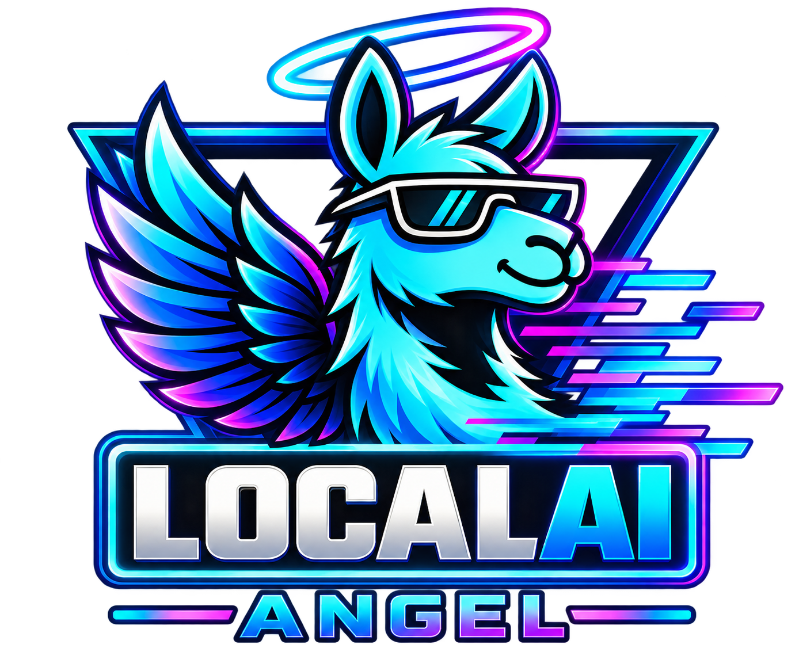

<div align="center">
  

  # LocalAI-Angel by TCDOVERLORD

  **A unified local AI platform combining Angel AI, LocalAI, and Angel Nexus.**

  
  
  

  **[🌐 Project Website](https://tcdoverlord.github.io/LocalAI-Angel/)** · **[📦 GitHub Repository](https://github.com/tcdoverlord/LocalAI-Angel)** · **[🐛 Report an Issue](https://github.com/tcdoverlord/LocalAI-Angel/issues)**

</div>

---

<p align="center">
  <a href="https://github.com/tcdoverlord/LocalAI-Angel/blob/main/assets/LocalAI-Angel%20Architecture%20Overview.png">
    
  </a>
</p>

---


## Table of Contents

- [Project Overview](#project-overview)
- [Architecture](#architecture)
- [Core Components](#core-components)
- [Features and Capabilities](#features-and-capabilities)
- [Requirements](#requirements)
- [Quick Start](#quick-start)
- [Control Center Video Guides](#control-center-video-guides)
- [Local Services](#local-services)
- [Models and Inference](#models-and-inference)
- [Persistent Data](#persistent-data)
- [Troubleshooting](#troubleshooting)
- [Security and Privacy](#security-and-privacy)
- [Development and Contributions](#development-and-contributions)
- [Project Links](#project-links)
- [License and Attribution](#license-and-attribution)

---

## Project Overview

LocalAI-Angel is an evolving AI engineering project built around three connected layers:

1. **Angel AI** — the assistant experience and conversational interface.
2. **LocalAI** — the inference and API layer for supported AI models and services.
3. **Angel Nexus** — a modular tools and integration environment.

The Windows Control Center provides buttons for Install / Repair, Start Angel, and Stop Angel. These actions launch the project's corresponding batch scripts, which manage the configured Docker services and Angel Harness runtime.

The goal is to create a practical foundation for local AI experimentation, assistant workflows, modular integrations, and future capabilities.

This is an actively evolving project. Features may vary by build, hardware, configuration, and service readiness. Refer to the current source code and launcher output when verifying a particular capability.

## Architecture

The project separates the assistant experience from the model-serving infrastructure and the tools that extend it.

| Layer | Purpose |
|---|---|
| Angel AI | Assistant interface, conversation workflows, and the Angel Harness runtime. |
| LocalAI | Model inference and API access for supported configurations. |
| Angel Nexus | Modular tools, integrations, and project execution capabilities. |
| Docker Compose | Coordinates the configured services and their dependencies. |
| Persistent storage | Keeps supported application data across service restarts. |

The exact interactions between these components depend on the current configuration and implementation.

## Core Components

### Angel AI

Angel AI is the primary assistant experience. It provides the user-facing entry point to the unified environment and connects to the configured model and runtime services.

The Angel Harness is included in the unified startup workflow. Its available features depend on the current implementation and configuration.

### LocalAI

LocalAI supplies an inference and API layer for supported models and services.

It is a separate component from the assistant interface. Its model gallery and API are exposed through the local service URL listed below.

Project startup may build the LocalAI service from source, so the first launch can take significantly longer than subsequent launches.

### Angel Nexus

Angel Nexus is the modular tools and integration layer. The unified Docker Compose configuration includes the Nexus override, and the launcher exposes the configured Nexus interface.

Available modules and actions depend on the current repository implementation. Review the module interface and current documentation before assuming a particular tool is available.

---

## Features and Capabilities

### Unified startup

The Windows Control Center launches the supplied batch scripts, which coordinate the configured services through Docker Compose.

### Local model provisioning

The current unified launcher configures `qwen2.5:3b` as the default model unless overridden by environment configuration. Model provisioning occurs automatically on first launch.

### Local service interfaces

The launcher reports the local addresses for Angel Home Base, LocalAI, Nexus, and the engineering/RAG API.

### Persistent application data

The Angel Harness configures a persistent data location for supported chat, memory, and knowledge data. Existing SQLite history is detected by the startup script, which asks for confirmation before continuing.

### Modular architecture

Separating the assistant, inference services, and integrations provides a foundation for independent development and future extensions.

### Engineering and troubleshooting

The project uses Docker Compose to coordinate its services. The Install / Repair script checks prerequisites, builds the configured images, starts the stack, and reports startup errors.

**Implementation note:** These capabilities describe the configured project architecture and launcher behavior. Individual features, APIs, memory functions, and integrations should be tested against the current build before being described as fully implemented or production-ready.

---

## Requirements

The unified launcher is a Windows batch file and uses Docker Compose.

Before starting, prepare the following:

- A supported Windows environment.
- Docker Desktop installed and running.
- Docker Compose available through the Docker CLI.
- An internet connection for initial image, source, and model downloads.
- Sufficient free disk space for container images, the LocalAI build, model files, and persistent application data.
- Enough available memory and compute resources for the selected model and services.

The default model download is several gigabytes. The first LocalAI source build can also require substantial disk space and time.

Actual performance depends on your processor, memory, storage, model, and available hardware acceleration.

## Quick Start

### Requirements

- Windows with Docker Desktop installed and running.
- Docker Compose available through the Docker CLI.
- Internet access for initial image builds, source downloads, and model provisioning.
- Enough disk space, memory, and compute resources for the configured services and model.

### 1. Get the project

Clone the repository or download it from **https://github.com/tcdoverlord/LocalAI-Angel**. Keep the Control Center executable and its batch scripts in the repository folder so the buttons can find the scripts.

### 2. Run Install / Repair

Open `AngelControlCenter.exe` and click **INSTALL / REPAIR**. This runs `INSTALL_ANGEL_V1.0.0.bat`, which is intended for both first-time setup and subsequent repair runs. Follow the console output and wait for the endpoint checks to finish.

You can also run the installer directly from PowerShell or File Explorer by launching `INSTALL_ANGEL_V1.0.0.bat` from the repository folder.

### 3. Start Angel

After installation completes, click **START ANGEL** in the Control Center. This launches `START_ANGEL.bat` to start the Compose stack. Wait for the services to initialize, then open Angel Home Base at:

**http://127.0.0.1:8765/**

### 4. Stop Angel

Click **STOP ANGEL** to run `STOP_ANGEL.bat`. This stops the configured services without intentionally deleting persistent data or model volumes.

### Repeat use

- **Everyday use:** use **START ANGEL** and **STOP ANGEL**.
- **First-time setup or repair:** use **INSTALL / REPAIR**.
- Keep Docker Desktop running while installing or starting the stack.

## Control Center Video Guides

These recordings demonstrate the three main actions in the LocalAI-Angel Control Center.

GIFs animate automatically. For playback controls such as pause, resume, and seeking, use an MP4 video hosted on a page that supports video controls.

### Install / Repair

<p align="center">
  <a href="https://github.com/tcdoverlord/LocalAI-Angel/blob/main/docs/images/angel-install.gif">
    
  </a>
</p>

[Open Install / Repair GIF](https://github.com/tcdoverlord/LocalAI-Angel/blob/main/docs/images/angel-install.gif)

### Start Angel

<p align="center">
  <a href="https://github.com/tcdoverlord/LocalAI-Angel/blob/main/docs/images/angel-start.gif">
    
  </a>
</p>

[Open Start Angel GIF](https://github.com/tcdoverlord/LocalAI-Angel/blob/main/docs/images/angel-start.gif)

### Stop Angel

<p align="center">
  <a href="https://github.com/tcdoverlord/LocalAI-Angel/blob/main/docs/images/angel-stop.gif">
    
  </a>
</p>

[Open Stop Angel GIF](https://github.com/tcdoverlord/LocalAI-Angel/blob/main/docs/images/angel-stop.gif)

---

## Local Services

The current local stack uses these default addresses:

| Component | Local URL | Purpose |
|---|---|---|
| Angel Home Base | [http://127.0.0.1:8765](http://127.0.0.1:8765) | Main Angel interface |
| LocalAI | [http://127.0.0.1:8080](http://127.0.0.1:8080) | LocalAI model gallery and API |
| Angel Nexus | [http://127.0.0.1:8877/](http://127.0.0.1:8877/) | Modular tools and integration interface |
| Engineering/RAG API | [http://127.0.0.1:8780](http://127.0.0.1:8780) | Engineering and retrieval API |

These are the launcher's configured defaults. A reachable URL does not necessarily mean every feature behind that interface is operational.

The interfaces use loopback addresses, so they are intended for access from the local machine unless you deliberately change the networking configuration.

## Models and Inference

### Default model

The current model configuration sets:

```text
ANGEL_DEFAULT_MODEL=qwen2.5:3b
```

The launcher provisions this default model automatically on first launch unless an environment override changes the configuration.

The model download can be several gigabytes. Allow additional time for the initial setup.

### LocalAI and Ollama

The unified setup includes an Ollama fallback setting and a LocalAI service. These are related to the AI infrastructure but are not the same service.

- **Ollama** can provide model provisioning and local model execution for the configured assistant path.
- **LocalAI** provides its own supported inference and API layer.
- **Angel AI** is the assistant experience that uses the configured runtime.

Do not assume every model, API, or provider configuration works interchangeably. Check the current environment configuration and service documentation.

### Hardware considerations

Model performance and compatibility depend on:

- Available system memory.
- CPU and GPU capabilities.
- Model size and quantization.
- Storage capacity and speed.
- Runtime configuration and hardware acceleration support.

Start with the configured default model before changing model settings. If you select a larger model, check its requirements first.

## Persistent Data

The startup configuration reports the persistent data location and configures the default user data path under:

```text
%USERPROFILE%\Angel_Platform
```

If the relevant environment variable is not available, the launcher uses a project-relative fallback location.

The configured location is intended to preserve supported chat, memory, and knowledge data across service restarts. Actual persistence depends on the relevant application and storage configuration.

### Existing Angel history

The launcher checks for an existing SQLite history database and asks whether to continue using it in place.

If you are unsure whether the existing data is compatible, cancel startup and make a backup before proceeding.

**Do not delete persistent data folders as a troubleshooting shortcut.** Back up your data before migrations, storage changes, or destructive maintenance.

## Troubleshooting

### Docker is unavailable

If Install / Repair or Start Angel reports that Docker is missing or the engine is unavailable:

1. Start Docker Desktop.
2. Wait until the engine finishes starting.
3. Run `docker version`.
4. Retry the unified launcher.

### The first startup takes a long time

Initial startup may download the model, pull images, build LocalAI, and initialize services.

Check Docker output and system resource usage before assuming the launcher is stuck. Make sure you have adequate disk space and a stable internet connection.

### Angel Home Base does not open

Try opening the URL manually:

```text
http://127.0.0.1:8765
```

Then inspect the launcher output and Docker container status:

```powershell
docker compose -f docker-compose.yaml -f docker-compose.nexus.override.yaml -f docker-compose.angel-harness.yaml ps
```

Use the same Compose files that the unified launcher uses.

### A service is not responding

Check whether the relevant container is running and review its logs:

```powershell
docker compose -f docker-compose.yaml -f docker-compose.nexus.override.yaml -f docker-compose.angel-harness.yaml logs --tail 100
```

If you need to narrow the output to a particular service, use the service name reported by Docker Compose.

A running container does not guarantee the application inside it is healthy. Check application logs and its documented health endpoint where available.

### Model or inference errors

Check that the configured model is available, that sufficient memory and disk space are available, and that the correct inference service is running.

Review the launcher output and model/runtime configuration before changing environment variables.

### Existing data prompts

If the launcher detects an existing SQLite history database, it asks whether to continue using it in place.

If you need to preserve the current data and are unsure what to do, cancel startup, back up the data folder, and investigate compatibility before continuing.

### Stopping the services

To stop the stack without deleting containers, models, or Nexus data, use the supplied stop script:

```powershell
.\STOP_ANGEL.bat
```

The script runs the configured Docker Compose stop operation. It is intended to stop services while preserving persistent data.

If the startup process fails, retain the terminal output and relevant logs when reporting the issue.

## Security and Privacy

Local inference can reduce dependence on hosted model providers, but local software should not automatically be assumed secure or fully offline.

- Review the network behavior of each configured component.
- Understand whether a selected model or service sends data to an external provider.
- Never commit API keys, access tokens, credentials, or private `.env` files.
- Keep Docker Desktop and project dependencies updated.
- Back up persistent data before upgrades or migrations.
- Avoid exposing local service ports to untrusted networks without appropriate security controls.
- Test tool actions and integrations before trusting them with important files or systems.

The default model path, optional integrations, and any externally hosted services can have different connectivity and privacy characteristics. Review the current configuration before using sensitive information.

## Development and Contributions

LocalAI-Angel is an evolving engineering project. Contributions, bug reports, documentation improvements, and reproducible test results can help improve its reliability.

Before proposing a change:

1. Review the existing implementation and project documentation.
2. Identify the component affected: Angel AI, LocalAI, Angel Nexus, or the launcher.
3. Reproduce the behavior where possible.
4. Record relevant logs and configuration details without exposing secrets.
5. Test the change and document any hardware or environment requirements.

When reporting an issue, include your operating system, Docker version, the relevant launcher output, and the steps needed to reproduce the problem.

Do not include API keys, tokens, private `.env` files, or personal data in public issues.

**[Open a GitHub issue](https://github.com/tcdoverlord/LocalAI-Angel/issues)** · **[View pull requests](https://github.com/tcdoverlord/LocalAI-Angel/pulls)**

## Project Links

- **Project repository:** https://github.com/tcdoverlord/LocalAI-Angel
- **Project website:** https://tcdoverlord.github.io/LocalAI-Angel/
- **Architecture overview:** https://github.com/tcdoverlord/LocalAI-Angel/blob/main/assets/LocalAI-Angel%20Architecture%20Overview.png
- **Angel AI Harness:** https://github.com/tcdoverlord/LocalAI-Angel/tree/main/Angel_AI_Harness
- **Styled HTML README:** https://github.com/tcdoverlord/LocalAI-Angel/blob/main/README.html
- **LocalAI documentation:** https://localai.io/
- **Issues:** https://github.com/tcdoverlord/LocalAI-Angel/issues
- **Pull requests:** https://github.com/tcdoverlord/LocalAI-Angel/pulls
- **Maintainer GitHub profile:** https://github.com/tcdoverlord
- **Technical portfolio:** https://tcdoverlord.github.io/Resume_TCDOVERLORD/

## License and Attribution

LocalAI-Angel brings together the Angel project and upstream software, including LocalAI. Each component may have its own license, attribution requirements, and redistribution terms.

Review the license files and notices included with the repository and its dependencies before distributing modified builds or bundled components. Do not assume every component uses the same license.

---

<div align="center">

**Built by [TCDOVERLORD](https://github.com/tcdoverlord)**

*Local AI. Modular tools. Practical engineering.*

</div>
